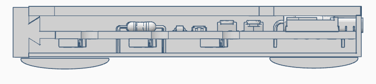
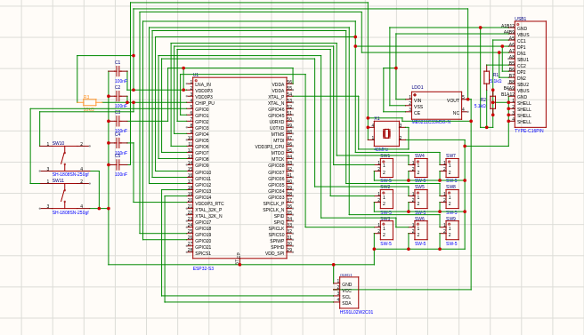
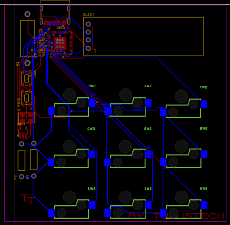

<div align="center">
  
  <br/>
  
</div>

# Keyo 9-Key Macropad

**Keyo** is a customizable 9-key mechanical macropad powered by an **ESP32-S3** microcontroller, featuring hot-swappable mechanical switches, a 0.91" OLED status screen, and a custom 3D-printed enclosure.

---

## Features

- **9 Mechanical Hot-Swappable Keys**: Standard Cherry MX-style switches with Kailh hot-swap sockets.
- **Customizable Actions**: Send keyboard shortcuts, macros, or media controls.
- **0.91" 128x32 OLED Display**: Real-time feedback showing the last pressed key and macropad status.
- **Native USB HID**: High-performance USB HID keyboard emulation powered by the ESP32-S3.
- **Non-Slip 3D Printed Case**: Layered enclosure with snap-in PCB holder and transparent top panel.

---

## Repository Structure

Following the Hackpad standard:

```text
Keyo/
├── assets/          # Logos, banners, and layout screenshots
├── cad/             # Complete 3D CAD assembly files
├── firmware/        # Arduino source code, pinouts, and flashing guide
├── pcb/             # PCB BOM, pick & place files, and design info
├── production/      # Fabrication gerbers.zip and 3D printable STL files
├── BOM.csv          # Bill of Materials
└── README.md        # Project documentation
```

---

## Hardware Overview

### 3D Case Layout


### Circuit Schematic


### PCB Routing Layout


---

## Bill of Materials (BOM)

| Designator | Component / Part | Description | Qty |
| :--- | :--- | :--- | :--- |
| **U1** | ESP32-S3 | Dual-Core 240MHz MCU with native USB | 1 |
| **OLED1** | HS91L02W2C01 | 0.91" 128x32 I2C OLED Display | 1 |
| **SW1 - SW9** | CPG151101S11-16 | Kailh Cherry MX Hot-swap Sockets | 9 |
| **SW10, SW11** | SH-1808SN-250gf | SMD Tactile Push Buttons (Reset / Boot) | 2 |
| **USB1** | TYPE-C16PIN | 16-Pin USB Type-C Receptacle | 1 |
| **LDO1** | ME6211C33M5G-N | 3.3V 500mA LDO Regulator | 1 |
| **X1** | OVETGLJANF-40MHZ | 40MHz Crystal Oscillator | 1 |
| **R1, R2** | 5.1kΩ Resistors | CC1/CC2 Pull-down for USB-C | 2 |
| **R3** | 10kΩ Resistor | Pull-up Resistor | 1 |
| **C1 - C5** | 100nF / 0.1μF | Decoupling Capacitors | 5 |
| **Case** | Main_Case.stl | 3D Printed Enclosure Base | 1 |
| **Holder** | PCB_Holder.stl | 3D Printed Internal Mount | 1 |
| **Panel** | Transparent_panel.stl | 3D Printed / Laser-cut Faceplate | 1 |
| **Cap** | Cap.stl | 3D Printed Top Cap | 1 |

---

## Quick Links

- [Firmware Documentation & Arduino Code](firmware/README.md)
- [PCB Fabrication & Pick-and-Place](pcb/README.md)
- [Production Files (Gerbers & STLs)](production/)
- [CAD Assembly File](cad/keyo_assembly.stl)
